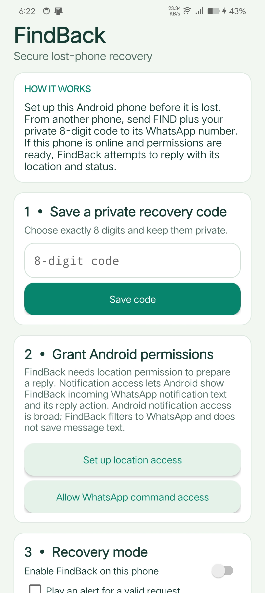
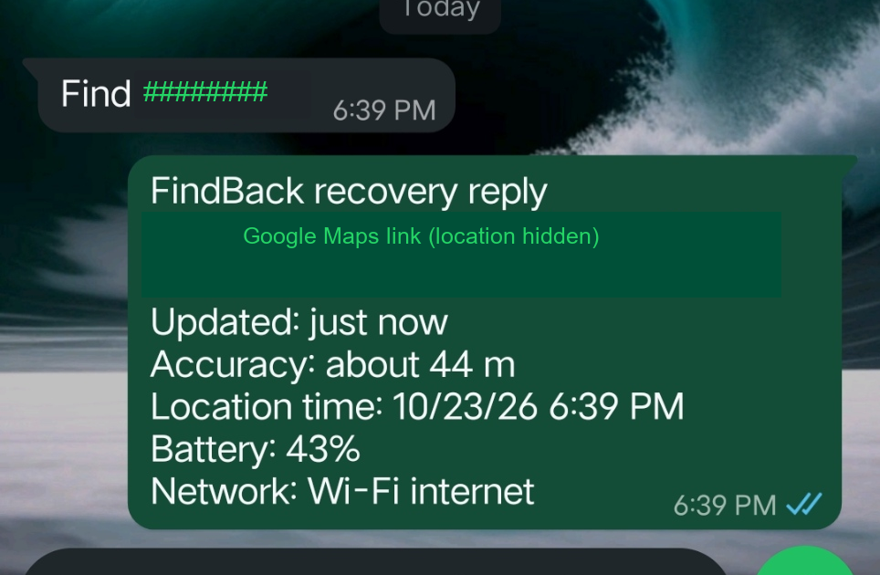
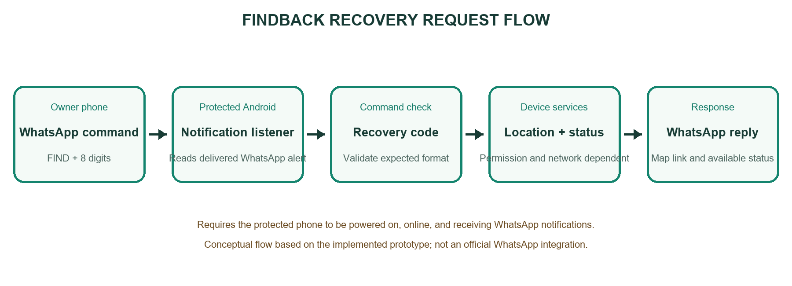

# FindBack - Android lost-phone recovery prototype

FindBack is a student Android prototype for requesting the available location and status of a phone that its owner prepared in advance. The protected phone listens for WhatsApp notifications and checks for a private command. It is not an official WhatsApp integration or a guaranteed device-tracking service.

## Demonstration

1. Install FindBack on the Android phone to protect.
2. Save an eight-digit recovery code, grant the required Android location and notification access, and enable Recovery mode.
3. From a second phone, send `FIND` followed by the saved code in a direct WhatsApp chat with the protected phone.
4. If the command is valid and the phone can access location, FindBack attempts to reply in the same chat with a Maps link and status details.

Use only a recovery code configured on your own test phone. Never publish or reuse your real recovery code.

## Screenshots

| FindBack setup | WhatsApp demonstration |
|---|---|
|  |  |

### Request flow

The demonstration screenshot has its code and exact location obscured. Unit-test source is included, but no successful test result is claimed.

## Main components

- `MainActivity.java` - setup screen, code saving, permission guidance, readiness, and Recovery mode.
- `RecoveryStore.java` - local salted code hash, request lockout/cooldown, and command parsing helpers.
- `WhatsAppCommandListener.java` - notification filtering, command validation, location/status collection, and notification reply attempt.
- `AndroidManifest.xml` - app entry point, permissions, and notification listener service.
- `RecoveryStoreTest.java` - unit-test source for code validation and command parsing.

## Technology

- Java 17
- Android Studio and Android SDK
- Android Gradle Plugin 8.13.2
- Gradle 8.13
- Minimum Android API 26; compile/target API 36
- WhatsApp notifications and Android location APIs

## Build on Windows

1. Install Android Studio with JDK 17 and Android SDK Platform 36.
2. Clone this repository and open its folder in PowerShell.
3. Run `.\gradlew.bat wrapper` once. The included bootstrap script obtains Gradle 8.13 if it is not already available and generates the standard Gradle wrapper files.
4. Open the project folder (containing `settings.gradle.kts`) in Android Studio and allow Gradle sync to finish.
5. Connect an Android phone with USB debugging enabled, select it as the run target, and click **Run**.

To create a debug APK, use **Build > Build Bundle(s) / APK(s) > Build APK(s)** in Android Studio. A first-time Gradle setup needs internet access to download build tools. No paid API or FindBack server is used.

## Privacy and security notes

- The recovery code is stored as a salted PBKDF2-HMAC-SHA256 hash in app-private storage, not as plain text.
- Notification access is broad at the Android system level. FindBack filters for WhatsApp/WhatsApp Business notifications, but the device owner must understand and consent to this access.
- Keep the recovery code private. Anyone who learns it could request a location; lockout and cooldown reduce some misuse but do not eliminate it.
- The command is not bound to a specific sender account or trusted phone. Anyone who knows the code and can message the protected phone may trigger a reply, and the location is sent back to the chat containing the command. Use only with people and accounts you trust.
- Test only with phones and accounts that you own or have permission to use.

## Limitations

- The protected phone must be powered on, online, signed in to WhatsApp, and receiving notifications to process a command and send a reply.
- Background location may be delayed or restricted by Android or device-maker battery settings. A cached location can be old; the app reports its age where available.
- WhatsApp notification content and inline reply actions vary across versions and devices. This approach is not guaranteed to work everywhere and does not use an official WhatsApp API.
- The app does not continuously track, upload location to a server, remotely unlock or erase the phone, or automatically save a location before shutdown.

## Testing

The repository includes unit-test source code for valid/invalid recovery codes and command parsing. Run the test task in Android Studio or with Gradle to verify it; do not infer a passing result from the source screenshot alone. The physical-phone demonstration is separate from unit-test execution.

## Third-party tools

The project uses Android platform APIs and JUnit for local unit tests. Android Gradle Plugin and Gradle are build tools. See [THIRD_PARTY_NOTICES.md](THIRD_PARTY_NOTICES.md).

## License

No license has been selected for this repository. Public visibility lets others view the project, but does not grant permission to reuse or redistribute its code.
